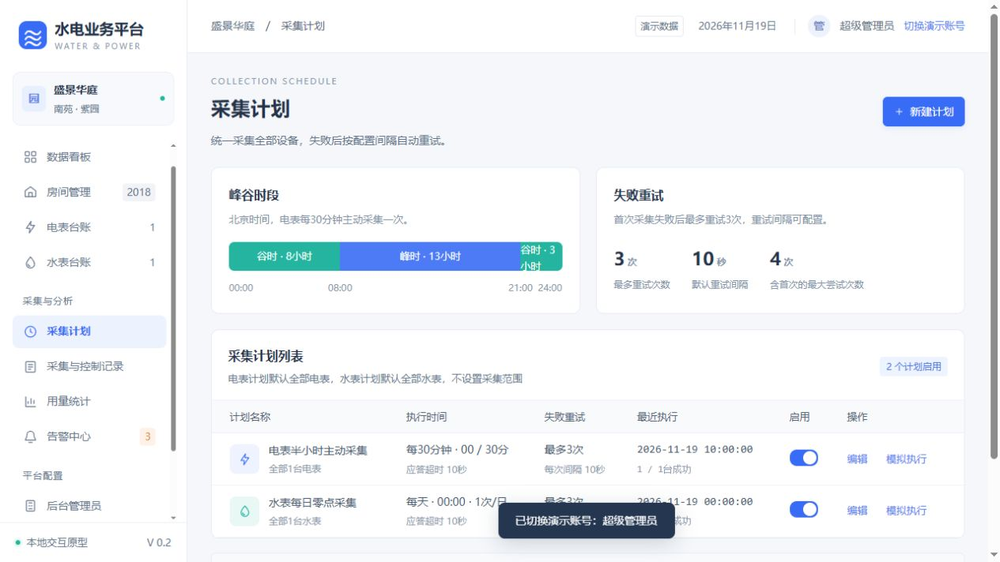
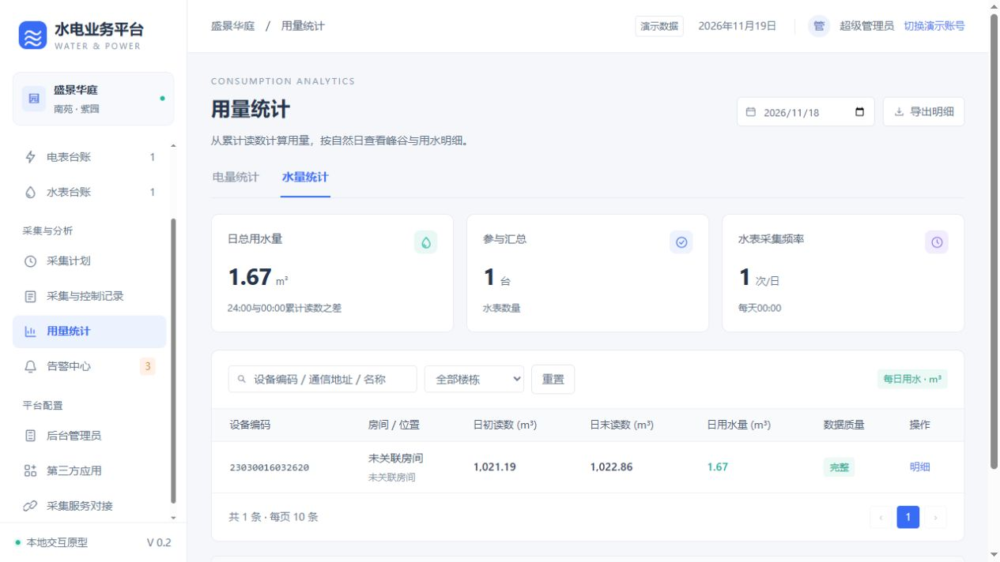
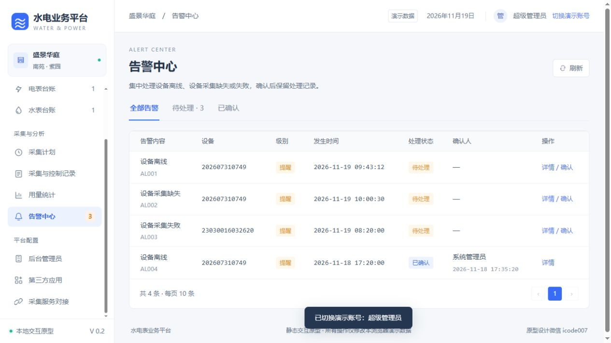
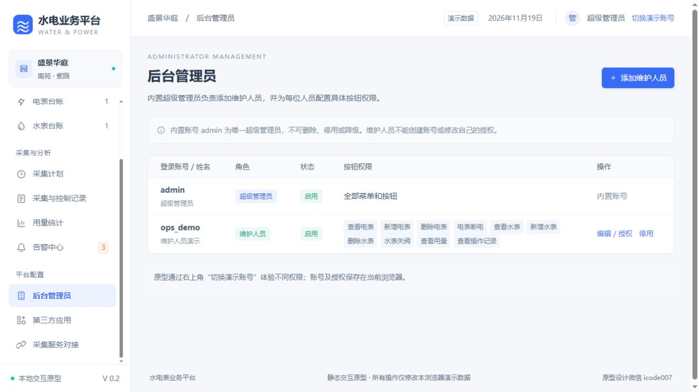
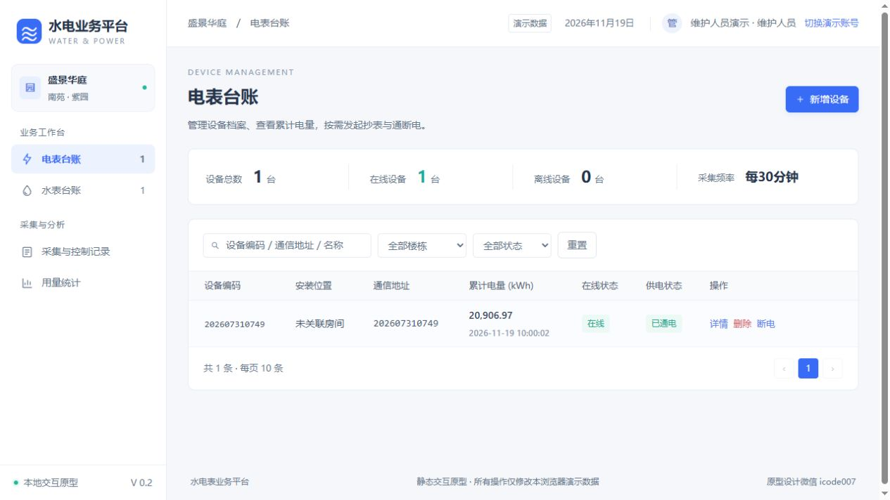

# 水电表业务平台

RuoYi-Vue单体业务平台的开发方案与本地交互原型。第三方应用支持查询、主动抄表、电表通断电及水表开关阀，均为本地模拟。当前仅展示2台设备：电表202607310749、水表23030016032620；台账首列仅显示设备编码。此目录为本次更新内容，仓库根目录原有采集平台原型保持独立。

- [在线预览](https://pianpu.github.io/water-energy-platform/business/)
- 双击[原型/index.html](原型/index.html)即可本地运行。
- 后台管理员：内置超级管理员admin添加维护人员，逐按钮授权；可用右上角“切换演示账号”体验。
- [使用说明](原型/使用说明.md)
- [需求确认](原型/需求确认.md)
- [开发方案](水电表业务平台开发方案.md)
- [修正及复查记录](原型修正及复查记录.md)

原型使用模拟数据，不连接真实设备。原型设计微信 icode007。

