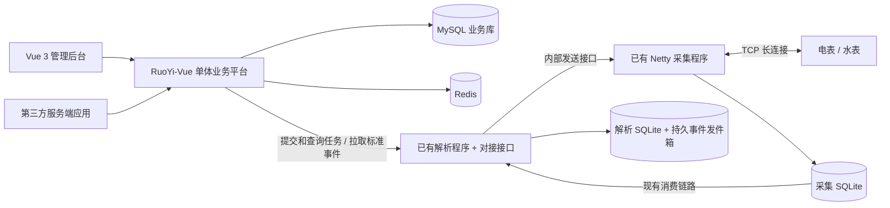
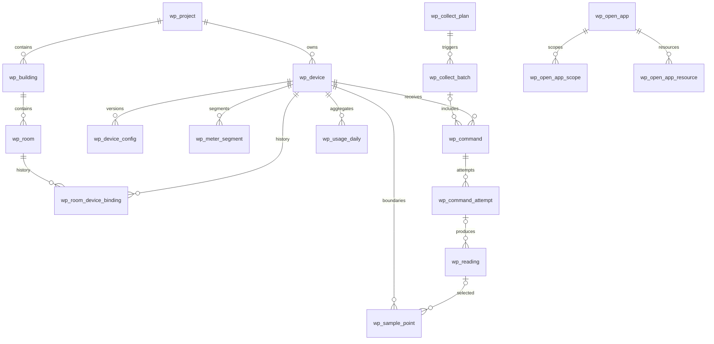

# 水电表业务平台开发方案

> **已按2026-11-19确认的原型需求统一修订。** 本文定义后续正式开发范围，原型仍为本地模拟，不表示真实后台、数据库或拟新增接口已经实现。功能口径与[原型需求确认](原型/需求确认.md)一致。

| 项目 | 内容 |
| --- | --- |
| 文档版本 | V1.1，原型需求同步稿 |
| 编制日期 | 2026-11-19 |
| 业务平台目录 | `E:\workspace\接单\水电表采集平台&业务平台` |
| 已有采集解析程序目录 | `E:\workspace\接单\Netty水电表采集程序` |
| 架构决定 | RuoYi-Vue 单体业务后端，独立对接已有采集端、解析端 |
| 数据采集决定 | 服务器定时主动抄表作为业务正式数据来源 |
| 默认业务时区 | `Asia/Shanghai` |
| 文档性质 | 功能、逻辑数据库和接口开发依据；拟新增接口不代表已经实现 |

## 目录

1. [建设目标与范围](#1-建设目标与范围)
2. [架构与技术栈](#2-架构与技术栈)
3. [现有程序核对与改造边界](#3-现有程序核对与改造边界)
4. [功能模块](#4-功能模块)
5. [采集、计量与统计规则](#5-采集计量与统计规则)
6. [任务执行与可靠性](#6-任务执行与可靠性)
7. [数据库设计](#7-数据库设计)
8. [业务平台与解析端对接接口](#8-业务平台与解析端对接接口)
9. [第三方开放接口](#9-第三方开放接口)
10. [后台接口与权限设计](#10-后台接口与权限设计)
11. [部署、容量与运维](#11-部署容量与运维)
12. [开发阶段与验收](#12-开发阶段与验收)
13. [待确认事项](#13-待确认事项)
14. [参考资料](#14-参考资料)

## 1. 建设目标与范围

### 1.1 已确定的设计

1. 业务平台使用 RuoYi-Vue，后端为一个 Spring Boot 单体应用，不采用 Spring Cloud。
2. 已有 Netty 采集端继续维护设备 TCP 连接、接收及保存原始字节、执行必要的协议确认和发送指令。
3. 已有解析端继续识别设备、解析厂商协议、构造指令、关联应答、核验电表闸状态。
4. 业务平台制定采集计划、创建任务、长期保存标准读数、计算用量、管理房间设备关系并对外开放应用接口。
5. 电表每半小时主动抄表；峰时为 `08:00–21:00`，谷时为 `00:00–08:00、21:00–24:00`。
6. 水表每天 `00:00` 主动抄表一次，失败后最多重试3次，间隔可配置（默认10秒）；按日初与日末累计读数差统计每日水量，日末显示为 `24:00`。
7. 只有管理后台和定时调度创建设备任务；第三方应用仅查询设备、用电量和用水量，不创建或查询设备任务。

### 1.2 第一版交付范围

- 用户角色、菜单按钮权限、项目数据权限及操作日志。
- 项目、楼栋、房间、设备档案和绑定/换表历史。
- 设备发现待认领、连接状态、心跳或最后通信、最后成功抄表时间。
- 电表/水表采集计划、采集批次、逐设备任务、失败原因和缺失点查询。
- 半小时电量、每日峰谷电量、每日水量、月度汇总和导出。
- 手动抄表、电表断电/通电、任务状态及结果查询。
- 告警中心、通信记录索引、第三方应用管理及开放接口文档。
- 与解析端可靠交付标准事件的接口及必要的适配改造。

### 1.3 暂不纳入第一版

- 充值、支付、余额写入、自动欠费断电、完整计费结算、合同及账单。
- 水表阀控、清表、远程写参数、通用十六进制指令发送。
- 自研设备协议、替代已有采集程序、将其 SQLite 原始库迁入业务 MySQL。
- Spring Cloud、注册中心、独立微服务网关、分布式事务、Kafka。
- 默认向第三方推送 Webhook；第一版通过设备、用电量和用水量查询接口完成对接。

后续如引入计费，必须另行确认费率、精度、冻结读数、结算和更正机制。本方案中的峰谷规则首先用于指定时段的能耗统计。

## 2. 架构与技术栈

### 2.1 系统架构



业务平台不持有真实 Netty Channel，不拼装厂商报文，不直接消费原始字节队列。标准结果交付与已有“采集端到解析端”的原始事件消费确认是两套独立流程。

### 2.2 技术选择

| 部分 | 选型 | 说明 |
| --- | --- | --- |
| 基础框架 | 官方 RuoYi-Vue，`springboot3` 分支 | 开工时锁定实际发布版本与提交号，保留上游版本记录 |
| Java | JDK 17 LTS | 与已有程序基线一致 |
| 后端 | Spring Boot 3、Spring Security、MyBatis | 沿用框架技术体系，不另换 ORM |
| 数据库 | MySQL 8.4 LTS、InnoDB、utf8mb4 | 业务数据、任务、标准读数及统计 |
| Redis | 与锁定框架兼容的受支持版本 | 后台会话、应用令牌、短期缓存、限流；业务任务不能只存 Redis |
| 调度 | 若依已有 Quartz 模块 | 触发批次与检查任务；逐设备执行使用独立工作线程池 |
| 前端 | 官方 Vue 3 前端、Element Plus、ECharts | 页面、表格与统计图表 |
| 服务调用 | HTTP JSON，连接池、显式超时 | 调用解析端，不引入服务发现 |
| 数据库升级 | 版本化 SQL 迁移 | 基线脚本与每次增量脚本入库管理，发布时顺序执行，禁止自动清库 |
| 接口文档 | OpenAPI 3 | 明确认证、字段、错误码、异步状态、时间与单位 |
| 部署 | Linux、Nginx、Docker Compose | 同机部署优先，采集解析保持现有进程与数据目录 |

若依提供通用后台能力，但第三方应用认证、可靠设备任务和能耗统计属于本项目新增能力。官方版本定位见 [RuoYi-Vue 文档](https://doc.ruoyi.vip/ruoyi-vue/)。

### 2.3 工程组织建议

```text
ruoyi-admin        启动入口、后台与开放接口 Controller、安全链配置
ruoyi-framework    沿用框架基础设施
ruoyi-system       沿用用户角色、菜单、字典等
ruoyi-quartz       批次触发、任务检查、统计重算触发
ruoyi-common       框架公共能力
ruoyi-meter        项目房间、设备、采集、读数、统计、告警业务
ruoyi-openapi      应用凭证、三类查询授权、限流、调用审计
ruoyi-integration  解析端 HTTP 客户端、事件消费、协议版本适配
ruoyi-ui           Vue 3 页面
```

新增模块属于同一 Maven 工程，最终运行一个业务后端应用。后台任务 Controller 调用任务 Service；第三方查询 Controller 仅调用查询 Service，不调用任务或设备发送服务。初期也可将后三个模块按包组织，保持相同依赖边界。

## 3. 现有程序核对与改造边界

本节依据指定目录的 README、主动抄表/水表/闸控文档及 `ParserService`、`ActiveReads`、`ParserDatabase`、`LocalHttp` 源码核对；核对日期为 2026-11-19。本次只核对代码和文档，未连接真实设备验证。

### 3.1 已具备的能力

| 项目 | 现有实现 |
| --- | --- |
| 进程 | collector、parser、simulator 独立运行 |
| 默认设备 TCP | `0.0.0.0:18080` |
| 默认采集内部 HTTP | `127.0.0.1:18081`，内部接口使用 Bearer 令牌 |
| 默认解析网页 HTTP | `127.0.0.1:18082` |
| 原始持久化 | collector.db：`tcp_session`、`raw_event` 两张业务表 |
| 解析持久化 | parser.db：消费进度、设备、请求、最近历史等 |
| 电表主动抄表 | `POST /api/read-meter`，读取 `00910200` |
| 水表主动抄表 | 同一接口，支持 `03`、`12` 读命令，当前按解析端配置选择 |
| 电表控制 | `POST /api/relay`，支持短确认后的自动状态读回 |
| 互斥 | 同设备抄表和闸控共用一个待响应槽 |
| 结果展示 | `/api/dashboard` 中的最新请求、状态和近期历史 |

### 3.2 不能直接作为生产对接契约的部分

1. `/api/read-meter` 仅传 `meterAddress`，由解析端生成请求号；不能满足业务任务跨重启幂等提交。
2. dashboard 返回“最新请求”，并非按指定请求号稳定查询；并发使用时不能靠最新值确认某次任务。
3. 当前每表历史仅保留最近 60 点，请求约保留近期 2,000 条、压力下清理至 1,000 条；不能承担长期业务历史。
4. 当前解析网页操作接口默认本机使用，检查 JSON 和部分 Origin，但没有第三方应用认证体系；不能直接暴露到公网。
5. 采集 `/internal/send` 的请求号去重依赖本进程有界缓存，不能保证采集端重启后仍阻止相同 Socket 指令重放。
6. 原始 SEND 事件首先代表持久化的发送意图，不等于设备已经收到，也不能当作精确实际采样时间。
7. 厂商报文没有请求流水号，同格式周期上报、迟到旧应答仍可能落入新请求匹配窗口。
8. 当前解析设备状态不能直接作为业务授权档案；发现设备后仍需业务认领和分配项目。

因此新增版本化内部对接接口，现有本机页面接口保留用于联调兼容。生产定时采集和控制任务不依赖 dashboard 轮询完成。

### 3.3 必须固定的协议含义

| 内容 | 当前含义及要求 |
| --- | --- |
| 电表地址 | 12 位数字字符串，保留前导零 |
| 水表通信地址 | 14 位 HEX，按现有原始 7 字节顺序，不直接当铭牌 BCD 表号 |
| 电表 `OPEN` | 开闸/拉闸，实际断电 |
| 电表 `CLOSE` | 关闸/合闸，实际通电 |
| 电表反馈 `CLOSED` | 已合闸；与请求动作 `CLOSE` 区分 |
| 水表 `12` | 读数除数未由原文明确，现有默认 1000，必须实机确认 |
| 水表 `03` | 文档明确除以 1000，单位 m³，仍须确认现场是否支持该 TCP 下发 |
| 水表身份登记 | 不能套用电表 6 字节裸心跳；保留必要上报、确认及登记流程 |

业务平台内部控制接口使用 `POWER_OFF`、`POWER_ON`、`DEENERGIZED`、`ENERGIZED`，由适配层映射旧端动作，避免“开/关”语义反转。第一版不提供水表通断控制。

### 3.4 改造归属

| 系统 | 第一版需要做的工作 |
| --- | --- |
| 业务平台 | 本方案业务模块、MySQL、任务调度、统计、应用开放接口 |
| 解析端 | 新内部 API、持久幂等命令、按请求查询、标准事件发件箱、消费确认、能力及健康接口 |
| 采集端 | 尽量复用现有接收/发送能力；如需补充发送完成证据，单独版本升级；不声称现有内存去重支持跨重启重发 |
| 模拟器 | 复用并扩展延迟、断线、短确认、重复响应、采集与解析重启等验收场景 |

## 4. 功能模块

### 4.1 功能清单

| 模块 | 页面/功能 | 关键业务规则 |
| --- | --- | --- |
| 数据看板 | 设备、采集成功率、今日电量/水量、峰谷占比、告警 | 水量与电量分开，不把缺失当零；标注统计完整性 |
| 项目与楼栋 | 项目、时区、楼栋、楼层信息 | 第一版非多租户 SaaS，按项目授权 |
| 房间管理 | 楼栋、楼层、房号、面积、入住状态、租户姓名/手机号、备注 | 同楼栋同楼层房号唯一；已入住时联系人必填；面积大于 0 且最多两位小数 |
| 设备台账 | 类型、通信地址、铭牌表号、型号、位置、能力 | 发现与正式档案分开；只有已认领且启用的设备参与计划 |
| 房间设备关联 | 绑定、解绑、换表、历史 | 每房当前最多一块水表与一块电表；每块表当前只属于一个房间 |
| 设备运行状态 | 连接、最后通信/心跳、最后抄表、闸/阀状态 | 通信状态和读数新鲜度分开；水表不伪造心跳 |
| 采集计划 | 电表半小时、水表每日00:00一次、全量设备、有效期 | 固定时钟触发，记录每台应采任务，不因离线跳过 |
| 采集任务 | 批次、逐表进度、错误、超时、晚到修正 | 仅定时和后台手动任务；区分电表抄表、水表抄表、电表断电、电表通电，同设备统一排队 |
| 读数与历史 | 最新累计值、历史、采样点、数据质量、导出 | 保留累计值和单位，不以瞬时功率代替电量 |
| 用量统计 | 半小时、日峰谷、日水量、月度、房间归属 | 支持缺失、部分、估算、异常、修订；默认不自动估算 |
| 电表操作 | 立即抄表、断电、通电、结果核验 | 后台控制需明确设备和实际动作；不自动重放控制指令 |
| 告警中心 | 设备离线、设备采集缺失/失败 | 规则去重、人工确认并记录确认人及时间；状态仅待处理、已确认 |
| 通信追溯 | 任务关联请求号、会话号、原始事件定位、受控查看报文 | 业务库保存引用及必要证据，不全量复制高频心跳原文 |
| 第三方应用 | 新增、停用、密钥重置、授权、IP、限流、日志 | 仅设备、用电量、用水量三类查询权限；数据范围逐请求核验 |
| 系统管理 | 用户角色、菜单、字典、参数、日志 | 复用若依；项目范围和设备范围另做业务约束 |

### 4.2 主要角色

- 系统管理员：基础设置、集成节点、用户和应用授权、采集计划维护。
- 项目管理员：所授权项目的档案、计划、统计、告警和按权限执行的设备操作。
- 运维人员：授权项目设备状态、手动采集、告警处理；通断电单独授权。
- 只读人员：授权范围内的设备、读数和统计。
- 第三方应用：独立应用主体，按接口 scope 和项目/幢号查询范围访问，不借用管理员账号。

若依超级管理员可按项目约定获得后台全局权限，但第三方应用不继承后台超级管理员权限。普通项目管理员不能给应用授予超出自己管理范围的资源。

设备与房间关联的统一口径：设备编号和自身名称始终独立保存。未关联显示自身名称/编号；显式关联后显示项目、幢号、单元、房号及设备类型；解绑恢复自身名称。台账、搜索、详情、操作确认和导出使用同一关联查询，当前显示名称不覆盖设备自身名称，历史用量归属按绑定历史计算。水表台账无“采集方式”列，两类设备在线状态仅在线/离线，电表供电状态仅已通电/已断电。

用量导出字段包含日期、设备编号、设备自身名称、显示名称、关联房间、安装位置及用量/质量；已关联采用房间位置，未关联显示未关联房间并保留手填安装位置。日末列明确标24:00。

## 5. 采集、计量与统计规则

采集计划按设备类型覆盖全部已纳管设备，不提供项目、幢号、房间、设备列表等范围选择。电表每30分钟、水表每天00:00一次；定时失败最多3次重试，间隔可配置默认10秒，从前一次失败结束起计时。

### 5.1 时间规则

1. 默认业务时区为 `Asia/Shanghai`，所有自然日、峰谷和计划按该时区计算。
2. MySQL 时间戳字段用 `DATETIME(3)` 存 UTC；项目 `DATE` 字段为业务时区自然日。应用与 JDBC 统一 UTC，禁止依赖服务器本地时区。
3. 接口时间采用带时区 RFC 3339，例如 `2026-11-19T08:00:00+08:00`，接收后标准化为 UTC。
4. 分别保存计划时间、发送意图时间、可取得的 Socket 写完成时间、采集端接收时间、设备采样时间、解析时间和业务入库时间。
5. 无设备采样时间时，接收时间只是测量时间代理；不能伪称其为设备精确采样时刻。
6. 半小时/日区间统一使用左闭右开 `[start,end)`；边界读数供相邻两个区间共享。

### 5.2 电表采集

- 每天 48 个计划触发点：`00:00` 至 `23:30`，每 30 分钟一次。
- 一天的 48 个半小时用量需要当天 `00:00` 至当天 `24:00` 共49个边界读数；日末与下一天日初共用一次采集，页面日末统一显示24:00。
- 采用累计正向有功电量 `totalEnergy`，单位 `kWh`。
- 设备首次纳管时可手动采基线；首个完整区间形成前标记数据不足，不能倒造历史。
- 定时计划按固定时钟生成；不能“完成后等待 30 分钟”导致计划漂移。
- 周期读数上报不进入正式计划采样点；设备识别、心跳和必要的协议确认继续接收。

### 5.3 峰谷计算

设 `E(t)` 为同一计量段内时刻 t 的累计正向有功电量。

```text
半小时电量 = E(区间结束) - E(区间开始)

当天峰电量 = E(当天21:00) - E(当天08:00)

当天谷电量 = [E(当天08:00) - E(当天00:00)]
           + [E(当天24:00) - E(当天21:00)]

当天总电量 = E(当天24:00) - E(当天00:00)
```

默认一天峰时 13 小时、26 个半小时区间；谷时 11 小时、22 个区间。`07:30–08:00` 为谷，`08:00–08:30` 为峰，`20:30–21:00` 为峰，`21:00–21:30` 为谷；不能按应答结束时所属时段给整个区间分类。

如果00:00、08:00、21:00和24:00四个边界完整，即使中间半小时点缺失，也可以计算日峰谷；此时“日峰谷完整”与“半小时曲线完整”必须分别展示。边界缺失且无冻结数据时，不得把跨峰谷的累计差全部归入一个时段。

峰谷时段存成带生效期的版本化规则，默认只有峰/谷两档。规则变更不覆盖旧版本；跨规则生效点的区间须切分，不能随新配置静默改变旧报表。

### 5.4 水表采集

- 每天 `00:00` 主动采集一次；首次失败后最多再重试3次，即最多4次尝试，默认间隔10秒且可配置。
- 当日用水量 = 当日 `24:00` 累计水量 − 当日 `00:00` 累计水量，单位 `m³`；日末与下一天日初共用同一次采集。
- 不安排中午采集，用水明细仅展示 `00:00`、`24:00` 两个边界读数。业务平台不提供倍率确认、待确认倍率卡片或按倍率确认状态筛选汇总的功能；协议数值转换由采集解析端处理。
- 没有午夜值时，展示“实际起止时间之间的用水量”，不能冒充准确自然日值。
- 电池水表需先确认在线窗口；仅按唤醒窗口可达的设备，不承诺任意时刻主动采集。
- 水表协议数值由采集解析端统一转换为标准单位 `m³`，业务平台直接使用标准读数计算，不设置倍率确认流程或倍率确认统计门槛。协议 `03/12` 的现场支持情况由采集解析端验证。

### 5.5 采样点选择与精度

每个计划点生成一条 `wp_sample_point`。原始标准读数全部留存，采样点单独引用被选中的读数，避免后来手动抄表覆盖计划读数。

建议初始参数（配置值，须经实机压测调整）：

| 参数 | 初始值 | 处理 |
| --- | --- | --- |
| 普通计划允许偏差 | 30 秒 | 超出后保留读数，点质量标记超窗 |
| 00:00/08:00/21:00 | 重点监控同一偏差目标 | 统计偏差与成功率，不声称所有表同秒测量 |
| 单次设备应答窗口 | 10 秒 | 与解析端能力协商，可配置在其支持范围内 |
| 采集失败重试 | 最多3次，默认间隔10秒 | 电表和水表定时采集均适用；首次加重试最多4次，每次独立日志，间隔可配置 |
| 自动插值估算 | 默认关闭 | 后续启用必须单独存估算来源和算法版本 |

规则：

1. 优先采用设备可信冻结时间；没有时按采集端接收时间判断偏差，并标明时间依据。
2. 正常采样点只能引用本计划任务的有效匹配读数；人工补选必须记录人员、原因和修订版本。
3. 同一设备、同一指标、同一计划时间只有一个当前采样点，可修订引用但不删除历史证据。
4. `WITHIN_WINDOW` 表示符合业务容差，不等于精确整点计量；以此计算的报表继承容差质量。
5. 后续若设备支持冻结/峰谷寄存器，应通过能力扩展另加来源，核对其时区、费率时段和标准单位后使用。

### 5.6 断线、异常和历史归属

- 断线恢复后读到的当前累计值不能补出过去半小时读数；可计算同一计量段两个实际时刻间总差，但不能无依据拆分峰谷。
- 累计读数倒退、归零、换表或解析标准单位修正建立新 `meter_segment`；禁止跨段直接相减。
- 解析端协议或标准单位修正产生新解析配置版本；保留历史接收值，按审批重算派生结果，不能覆盖原始标准读数。
- 同一实际时刻冲突值均保留并标记数据质量异常，默认不选为有效边界，待核查后明确选择。
- 没有读数与真实零用量分开：缺失为 `NULL` 和质量标记，零仅来自有效差值。
- 设备总用量与房间归属分开。房间用量按绑定历史计算，不能将当前绑定关系套到过去。
- 绑定变更尽量与边界对齐并采交接读数；跨变更且缺少切分读数的区间，设备总量可保留，房间归属标记 `UNALLOCATED`，不擅自按时间均摊。
- 日统计默认持续修订 7 天（可配置），更早迟到数据建立重算任务并留审计。历史修改后同步重算相关半小时、日和月结果。

## 6. 任务执行与可靠性

### 6.1 三类编号

| 编号 | 生成方 | 用途 |
| --- | --- | --- |
| `commandId` | 业务平台 UUID | 一次后台或定时操作，贯穿任务、内部对接和审计 |
| `clientRequestId` | 业务平台 UUID | 一次实际下发尝试，提交解析端时作为持久幂等键 |
| `requestId` | 解析端 | 解析程序内部请求标识；与尝试一对一映射 |

后台操作用内部幂等键避免重复创建命令；每次实际抄表重试生成新的 `clientRequestId`，同一次尝试的受理确认重提仍用原键。定时抄表失败最多重试3次；通断电不自动重试。第三方查询不创建业务命令。

### 6.2 主流程

1. Quartz 到点创建批次，按设备类型冻结全部已纳管电表或全部已纳管水表的设备快照，不提供范围选择；离线设备也生成任务。
2. 工作线程获取同设备数据库租约，检查启用、项目、能力及执行期限。
3. 事务写入命令尝试和待提交状态，再调用解析端新接口；不在数据库事务里阻塞等待设备响应。
4. 解析端按 `clientRequestId` 持久幂等受理，串行处理同设备命令，再通过采集端发送。
5. 业务平台通过标准事件流接收请求状态、读数及核验结果，事务落库并推进消费游标。
6. 读数落库后安排增量统计重算，任务完成后释放设备租约；失败与未知结果有不同含义。
7. 应答失败后进入 `RETRY_WAIT`，从本次失败判定结束起等待配置间隔，最多再试3次；全部尝试完成后记录最终失败并产生设备采集缺失/失败告警。采样偏差只决定质量，不用于静默截断已配置的重试。总任务截止窗口应容纳4次应答窗口与3次间隔；超过总窗口仍无法下发的任务标记 `EXPIRED`，不伪装成按时读数。

### 6.3 业务命令状态

| 状态 | 含义 |
| --- | --- |
| `QUEUED` | 已创建，等待设备队列 |
| `SUBMITTING` | 正在与解析端确认受理 |
| `ACCEPTED` | 解析端已持久受理，不代表设备收到 |
| `SENT` | 已进入发送等待阶段；另保留发送证据类型 |
| `RETRY_WAIT` | 抄表本次失败，等待配置间隔后开始下一次尝试 |
| `VERIFYING` | 电表短确认后正在读回实际闸状态 |
| `SUCCEEDED` | 抄表读数有效，或控制目标状态已得到确认 |
| `FAILED` | 已知原因失败，如参数错误、设备明确拒绝、状态不一致 |
| `OFFLINE` | 无可用连接或等待期间断线，另标记是否可能已发送 |
| `TIMEOUT` | 响应窗口内尚未匹配有效结果；可能存在解析积压 |
| `UNKNOWN` | 网络/进程中断导致发送或实际结果无法确认 |
| `EXPIRED` | 任务已过允许下发期限且未执行 |
| `CANCELLED` | 在进入发送前取消 |

状态采用 `revision` 单调递增。旧版本事件不能回退新状态。按时接收但因积压晚解析的读数可修正 `TIMEOUT`，需保留状态事件和修订原因；不能简单把所有超时当作永远不可变化的终态。

`execution_certainty` 另记 `NOT_SENT / MAY_HAVE_EXECUTED / CONFIRMED`。例如控制任务断线或超时，不等于设备没有执行。向用户显示“结果未确认”，而非自动声称断电失败。

### 6.4 同设备互斥与调度

- 定时和后台共用设备队列；解析端仍做最后一道互斥，兼容保留的联调页面。
- 业务库 `wp_device_lock` 使用租约、CAS 版本和 fencing token，Redis 只辅助，不能作为唯一互斥依据。
- 业务线程丢失租约后不再提交；解析端持久命令和同设备互斥必须阻止重叠执行。
- 不同设备可受控并发；初始并发 32、队列上限 10,000 为待压测参数，不是容量承诺。
- 定时边界采集设保留额度；额外手动抄表限流，避免挤占计划窗口。
- 已经下发的操作不被抢占；控制与采集的冲突形成明确排队/忙返回，不能交叉发送。
- 不为每块设备创建一个 Quartz Job；用少量批次触发器生成逐表命令和独立执行队列。

### 6.5 不确定提交与重启

业务平台调用解析端超时时，先以原 `clientRequestId` 查询；新接口支持相同参数、相同键重提并返回原命令，不新发指令。解析端受理幂等键和命令必须同事务落盘。

解析端调用采集端前必须持久保存“发送调用已开始”。如果调用中断或重启且无法证明没有发到 Socket，恢复为 `UNKNOWN`，不再次调用采集端发送控制命令。已有采集端仅内存去重，不能以相同 UUID 在重启后重发来宣称 exactly-once。

如未来要求故障后自动恢复重发，需另行增加采集端持久发送去重和边界状态设计；即便如此，厂商设备无事务流水号时，仍不能保证物理动作端到端严格执行一次。

### 6.6 可靠结果交付

- 解析端在保存解析状态/消费进度的同一 SQLite 事务中写入标准事件发件箱。
- 业务平台按独立游标批量拉取，先在 MySQL 同一事务完成 inbox 去重、读数/任务落库、重算任务入队和游标推进，提交成功后才向解析端确认。
- 确认丢失允许重复拉取和重复确认；唯一键防止重复累计和重复状态事件。
- 未确认事件不按保留天数直接删除；积压、磁盘和最早未确认年龄写内部运维日志并在健康接口体现。
- 解析端旧的 60 点/2,000 请求清理不能删除未确认 outbox 或尚需幂等/核验的命令。
- 无法解析的事件或版本不兼容时暂停该流并写内部运维日志，不静默跳过。修复后从相同游标继续。

## 7. 数据库设计

### 7.1 统一约定

本节是可用于生成 DDL 的逻辑设计，列出主字段、类型、关系、唯一键和索引；最终建表脚本需结合锁定的若依版本生成、评审并做 MySQL 约束验证。

| 项目 | 约定 |
| --- | --- |
| 业务表前缀 | `wp_`，避免混入若依 `sys_` 表 |
| 普通主键 | `id BIGINT` 自增；接口输出 BIGINT 为字符串，防止 JavaScript 精度丢失 |
| UUID | `CHAR(36)`，用于命令、尝试、事件流实例 |
| 外键字段 | `BIGINT`，与引用主键同类型；高频流水表不做级联删除 |
| 时间 | `DATETIME(3)`，UTC；自然日 `DATE`，月份 `CHAR(7)` 如 `2026-11` |
| 累计值/用量 | `DECIMAL(20,6)`；Java BigDecimal；接口用十进制字符串 |
| 标准单位 | 解析端输出 `kWh` 或 `m3`；业务平台不维护或重复应用倍率/除数 |
| 面积 | `DECIMAL(12,2)`，必须大于 0 |
| 状态 | `VARCHAR(32)` + 字典 + 服务端枚举校验，不依赖前端字典保证有效 |
| JSON | 扩展字段、证据、规则快照；高频筛选字段必须独立列 |
| 通信地址/键 | 大小写规范化后保存；技术标识使用区分大小写的列排序规则 |
| 主数据通用审计 | `created_by BIGINT`、`created_at DATETIME(3)`、`updated_by BIGINT NULL`、`updated_at DATETIME(3)`、`remark VARCHAR(500) NULL` |
| 乐观锁 | 可变状态、版本配置引用使用 `version BIGINT NOT NULL DEFAULT 0` |
| 删除 | 有历史引用的设备/房间/应用归档停用，不物理删除；不在唯一键里简单附加删除标志 |
| 非空 | 主键、业务身份、状态、生效开始时间必填；结束时间、未取得证据、未计算用量允许 NULL |

除特殊说明外，主数据使用通用审计字段；高频流水至少保留 `created_at`，状态历史追加保存。不同项目之间的引用、设备类型与指标一致性必须在服务端验证。示例中的 DECIMAL 不能自动扩大设备原有计量精度。

### 7.2 复用若依表

复用锁定版本中的 `sys_user`、`sys_role`、`sys_menu`、用户角色及角色菜单关系、部门、字典、参数、操作日志、登录日志、`sys_job` 和 `sys_job_log`。具体字段以该版本原始 SQL 为准，不在本方案重复定义。

本方案建议将 Quartz 配置为 JDBC JobStore，建表使用匹配 Quartz 版本的 `QRTZ_*` SQL；若依有任务页面不代表已经完成该配置。应用每次启动禁止运行清空调度表的初始化脚本。业务任务恢复与幂等始终依赖下述 `wp_` 表。

### 7.3 基础档案与权限表

| 表 | 主要字段（除 id 与通用审计） | 约束及索引 |
| --- | --- | --- |
| `wp_project` 项目 | `project_code VARCHAR(64)`、`project_name VARCHAR(128)`、`timezone VARCHAR(64)`、`status VARCHAR(32)` | 唯一 `project_code`；首版默认上海时区，已有历史时不能直接改时区 |
| `wp_building` 楼栋 | `project_id BIGINT`、`building_code VARCHAR(64)`、`building_name VARCHAR(128)`、`sort_no INT` | 唯一 `(project_id,building_code)` |
| `wp_room` 房间 | `project_id BIGINT`、`building_id BIGINT`、`unit_name VARCHAR(32)`、`floor_no VARCHAR(16)`、`room_no VARCHAR(32)`、`area DECIMAL(12,2)`、`occupancy_status VARCHAR(32)`、`tenant_name VARCHAR(64) NULL`、`tenant_phone VARCHAR(32) NULL` | 唯一 `(building_id,unit_name,floor_no,room_no)`；入住时联系人必填；索引 `(project_id,occupancy_status)`；手机号只向有权限者展示 |
| `wp_user_project` 用户项目权限 | `user_id BIGINT`、`project_id BIGINT` | 唯一 `(user_id,project_id)`；后台角色权限与该资源范围取交集 |

楼层规范化保存，例如 `1`、`2`、`B1`，不要混用“一楼/1层”。房间入住状态为 `UNKNOWN/VACANT/OCCUPIED/CHECKED_OUT`；项目、幢号、单元、楼层和房号依据安装对照表，南苑1,622间、紫园396间。保留幢号前导零，不导入门锁要求、安装要求或完成情况。水电表独立建档并手动关联，设备名称不得预设房间。

### 7.4 集成、设备与计量配置表

| 表 | 主要字段 | 约束及索引 |
| --- | --- | --- |
| `wp_integration_node` 解析节点 | `node_code VARCHAR(64)`、`node_name VARCHAR(128)`、`base_url VARCHAR(255)`、`credential_ref VARCHAR(128)`、`status VARCHAR(32)`、`api_version VARCHAR(32) NULL`、`health_status VARCHAR(32)`、`last_health_at DATETIME(3) NULL` | 唯一 `node_code`；凭证保存为部署密钥引用，不能返回前端；默认一个节点 |
| `wp_discovered_device` 发现设备 | `node_id BIGINT`、`meter_type VARCHAR(16)`、`meter_address VARCHAR(32)`、`first_seen_at DATETIME(3)`、`last_seen_at DATETIME(3)`、`identity_status VARCHAR(32)`、`claim_status VARCHAR(32)`、`claimed_device_id BIGINT NULL`、`details JSON NULL` | 唯一 `(node_id,meter_type,meter_address)`；未认领设备不出现在第三方接口 |
| `wp_device` 业务设备 | `device_code VARCHAR(64)`、`project_id BIGINT`、`node_id BIGINT`、`meter_type VARCHAR(16)`、`meter_address VARCHAR(32)`、`device_name VARCHAR(128)`、`installation_position VARCHAR(255) NULL`、`nameplate_no VARCHAR(64) NULL`、`model VARCHAR(64) NULL`、`phase_type VARCHAR(16) NULL`、`status VARCHAR(32)`、`current_config_id BIGINT NULL`、`current_segment_id BIGINT NULL` | 唯一 `device_code`；唯一 `(node_id,meter_type,meter_address)`；索引 `(project_id,meter_type,status)` |
| `wp_device_config` 解析配置引用版本 | `device_id BIGINT`、`config_no INT`、`protocol_profile VARCHAR(64)`、`read_command VARCHAR(16)`、`capabilities JSON`、`valid_from DATETIME(3)`、`valid_to DATETIME(3) NULL` | 唯一 `(device_id,config_no)`；仅保存解析配置标识及能力快照，供协议版本追溯；不设置倍率或倍率确认状态，同设备有效期不重叠 |
| `wp_meter_segment` 连续计量段 | `device_id BIGINT`、`segment_no INT`、`config_id BIGINT`、`started_at DATETIME(3)`、`ended_at DATETIME(3) NULL`、`reason VARCHAR(32)`、`start_reading_id BIGINT NULL`、`end_reading_id BIGINT NULL` | 唯一 `(device_id,segment_no)`；索引 `(device_id,started_at)`；同设备计量段不重叠 |
| `wp_room_device_binding` 绑定历史 | `project_id BIGINT`、`room_id BIGINT`、`device_id BIGINT`、`meter_type VARCHAR(16)`、`valid_from DATETIME(3)`、`valid_to DATETIME(3) NULL`、`start_reading_id BIGINT NULL`、`end_reading_id BIGINT NULL`、`change_reason VARCHAR(255)` | 历史索引 `(device_id,valid_from,valid_to)`、`(room_id,meter_type,valid_from)`；当前唯一约束见下文 |
| `wp_device_runtime` 当前运行快照 | `device_id BIGINT` 作为主键、`node_id BIGINT`、`stream_epoch CHAR(36)`、`device_revision BIGINT`、`online TINYINT`、`can_read TINYINT`、`last_seen_at DATETIME(3) NULL`、`last_heartbeat_at DATETIME(3) NULL`、`last_reading_id BIGINT NULL`、`last_success_read_at DATETIME(3) NULL`、`relay_state VARCHAR(32)`、`relay_confirmed_at DATETIME(3) NULL`、`state_freshness VARCHAR(32)`、`updated_at DATETIME(3)` | 最新有效读数指针按时间与版本更新；旧事件不能覆盖新快照；解析节点不可达时标 `STALE/UNKNOWN`，不沿用“在线” |

设备迁移节点须显式执行迁移流程，保留原始事件中的源节点信息并重新建立运行状态；不能普通编辑通信地址掩盖换表。未经确认的瞬时功率单位、剩余值业务含义只存扩展字段，不纳入金额或用量统计。

绑定历史采用 `[valid_from,valid_to)`。第一版仅支持即时生效变更，不支持任意未来预约或普通用户回填过去。当前唯一约束建议使用生成列：

```sql
-- 以下仅为 wp_room_device_binding 的约束片段，不是完整建表脚本。
ALTER TABLE wp_room_device_binding
  ADD COLUMN active_device_id BIGINT
    GENERATED ALWAYS AS (IF(valid_to IS NULL, device_id, NULL)) STORED,
  ADD COLUMN active_room_id BIGINT
    GENERATED ALWAYS AS (IF(valid_to IS NULL, room_id, NULL)) STORED,
  ADD UNIQUE KEY uk_binding_active_device (active_device_id),
  ADD UNIQUE KEY uk_binding_active_room_type (active_room_id, meter_type),
  ADD CONSTRAINT chk_binding_period CHECK (valid_to IS NULL OR valid_to > valid_from);
```

换表事务按稳定顺序锁定房间及涉及设备，先关闭旧绑定再插入新绑定。生成列保证“当前唯一”，历史区间重叠仍由持锁后的业务校验保证；单独的结束时间非空不能证明历史不重叠。

### 7.5 采集计划与命令表

| 表 | 主要字段 | 约束及索引 |
| --- | --- | --- |
| `wp_collect_plan` 采集计划 | `plan_code VARCHAR(64)`、`plan_name VARCHAR(128)`、`meter_type VARCHAR(16)`、`schedule_kind VARCHAR(32)`、`schedule_config JSON`、`timezone VARCHAR(64)`、`retry_max INT DEFAULT 3`、`retry_interval_seconds INT DEFAULT 10`、`allowed_deviation_seconds INT`、`dispatch_deadline_seconds INT`、`response_timeout_seconds INT`、`enabled TINYINT`、`version BIGINT` | 唯一plan_code；每类型一条全量计划，电表每半小时、水表每天00:00一次；不设置范围字段；新批次保存版本快照 |
| `wp_collect_batch_device` 批次全量设备快照 | `batch_id BIGINT`、`device_id BIGINT`、`meter_type VARCHAR(16)` | 唯一(batch_id,device_id)；按批次触发时所有同类型设备自动生成，只用于追溯，不能手动配置采集范围 |
| `wp_collect_batch` 采集批次 | `plan_id BIGINT`、`scheduled_at DATETIME(3)`、`plan_version BIGINT`、`plan_snapshot JSON`、`status VARCHAR(32)`、`expected_count INT`、`success_count INT`、`failed_count INT`、`unknown_count INT`、`started_at DATETIME(3) NULL`、`completed_at DATETIME(3) NULL` | 唯一 `(plan_id,scheduled_at)`；计数可由命令重建，不根据 HTTP 受理数判断成功 |
| `wp_command` 业务命令 | `command_id CHAR(36)`、`project_id BIGINT`、`device_id BIGINT`、`node_id BIGINT`、`batch_id BIGINT NULL`、`source VARCHAR(16)`、`user_id BIGINT NULL`、`operation VARCHAR(32)`、`request_snapshot JSON`、`scheduled_at DATETIME(3) NULL`、`dispatch_deadline_at DATETIME(3)`、`status VARCHAR(32)`、`execution_certainty VARCHAR(32)`、`revision BIGINT`、`request_hash CHAR(64)`、`error_code VARCHAR(64) NULL`、`error_message VARCHAR(500) NULL`、`completed_at DATETIME(3) NULL` | 唯一 `command_id`；唯一 `(batch_id,device_id,operation)` 防重复计划任务；索引 `(status,dispatch_deadline_at)`、`(device_id,created_at)` |
| `wp_command_attempt` 下发尝试 | `command_id BIGINT`（引用 wp_command.id）、`attempt_no INT`、`client_request_id CHAR(36)`、`parser_request_id VARCHAR(64) NULL`、`status VARCHAR(32)`、`send_evidence VARCHAR(32)`、`submit_started_at DATETIME(3) NULL`、`send_intent_at DATETIME(3) NULL`、`socket_written_at DATETIME(3) NULL`、`response_deadline_at DATETIME(3) NULL`、`response_received_at DATETIME(3) NULL`、`session_id VARCHAR(64) NULL`、`request_snapshot JSON`、`result_snapshot JSON NULL` | 唯一 `client_request_id`；唯一 `(command_id,attempt_no)`；解析请求号按 `(node_id,parser_request_id)` 在业务校验，node 从父命令取得 |
| `wp_command_event` 命令状态历史 | `command_id BIGINT`、`attempt_id BIGINT NULL`、`stream_epoch CHAR(36) NULL`、`source_event_id BIGINT NULL`、`revision BIGINT`、`from_status VARCHAR(32) NULL`、`to_status VARCHAR(32)`、`event_at DATETIME(3)`、`reason VARCHAR(500) NULL`、`payload JSON NULL` | 索引 `(command_id,revision)`；外部事件以 inbox 去重，命令状态更新与该行同事务 |
| `wp_device_lock` 设备执行租约 | `device_id BIGINT` 主键、`owner_id VARCHAR(64)`、`command_id BIGINT NULL`、`lease_until DATETIME(3)`、`fencing_token BIGINT`、`version BIGINT`、`updated_at DATETIME(3)` | 获取/续租/释放使用 CAS；时间以数据库 UTC 为准 |

统一约定：表中关联 `command_id BIGINT` 表示内部主键，接口里的 `commandId` 为 `wp_command.command_id CHAR(36)`。代码实体与 SQL 别名必须明确区分，不能将 UUID 写入 BIGINT。业务源仅 `SCHEDULE/ADMIN`，不接受第三方创建任务。

每次首次请求及重试单独写入wp_command_attempt：attempt_no、status、sent_at、response_at、success_at、finished_at、error_code、error_message。通断电不自动重试，短确认后的读回核验保留为同一次尝试内的独立交换。

新增wp_command_exchange保存attempt_id、exchange_no、purpose、request_hex、response_hex、sent_at、response_at、validated_at，唯一(attempt_id,exchange_no)。请求/响应保存完整HEX，不仅保存截断摘要或原始日志引用；原始事件ID作为附加追溯信息。未发送则sent_at为空且HEX标待发指令；无响应则response_hex/response_at为空；失败/超时的success_at为空。时间精确到毫秒。

后台控制确认仅表示创建任务，最终成功须以实际状态读回核验为准。任务详情分电表抄表、水表抄表、电表断电、电表通电，展示每次请求、响应及重试，刷新后保留。

### 7.6 标准读数与计划采样点

| 表 | 主要字段 | 约束及索引 |
| --- | --- | --- |
| `wp_reading` 不可变标准读数 | `project_id BIGINT`、`device_id BIGINT`、`node_id BIGINT`、`stream_epoch CHAR(36)`、`source_event_id BIGINT`、`reading_key VARCHAR(160)`、`command_attempt_id BIGINT NULL`、`config_id BIGINT`、`segment_id BIGINT`、`metric VARCHAR(32)`、`unit VARCHAR(16)`、`raw_value VARCHAR(64) NULL`、`source_value DECIMAL(20,6)`、`normalized_value DECIMAL(20,6) NULL`、`device_sampled_at DATETIME(3) NULL`、`received_at DATETIME(3)`、`parsed_at DATETIME(3)`、`effective_at DATETIME(3)`、`time_basis VARCHAR(32)`、`source VARCHAR(32)`、`quality VARCHAR(32)`、`raw_event_id BIGINT NULL`、`stream_offset BIGINT NULL`、`details JSON NULL` | 唯一 `(node_id,reading_key)`；reading_key 自含 sourceEpoch，重建导出流后重放相同原始读数仍去重；索引 `(device_id,metric,effective_at,id)`、`command_attempt_id`；source_event_id 用于追溯，不用时间戳去重 |
| `wp_sample_point` 计划边界点 | `project_id BIGINT`、`device_id BIGINT`、`metric VARCHAR(32)`、`scheduled_at DATETIME(3)`、`command_id BIGINT`、`selected_reading_id BIGINT NULL`、`actual_at DATETIME(3) NULL`、`deviation_ms BIGINT NULL`、`quality VARCHAR(32)`、`revision BIGINT`、`selection_reason VARCHAR(255) NULL`、`updated_at DATETIME(3)` | 唯一 `(device_id,metric,scheduled_at)`；索引 `(project_id,scheduled_at,quality)`；修订写审计并触发重算 |

指标为 `TOTAL_ACTIVE_ENERGY`/`TOTAL_WATER_VOLUME`，单位分别 `kWh`/`m3`。解析端完成协议到标准单位转换，业务平台直接保存标准读数，`normalized_value = source_value`，不再次乘除或要求倍率确认；原始值可随报文保存供追溯。

`source` 可取 `ACTIVE_READ/CONTROL_VERIFY/UNSOLICITED/FROZEN`。第一版只有匹配的 ACTIVE_READ 进入常规采样点；控制核验和上报按来源保存或追溯，不自动补位。`reading_key` 由解析端稳定生成，例如源库世代、原始事件号、流偏移和指标组成，重复导出同一读数必须保持不变。

未认领设备的事件先进入 inbox 和发现表，不强行写入要求 project/config/segment 的正式读数表；认领时配置有效起点并记录是否授权导入旧读数。正式设备的迟到读数按命令携带的配置版本与实际有效时间归段，不能套用消费当时的最新解析配置。找不到可信配置或归段矛盾时隔离待核查。

### 7.7 峰谷规则与统计表

| 表 | 主要字段 | 约束及索引 |
| --- | --- | --- |
| `wp_energy_rule` 峰谷规则版本 | `project_id BIGINT`、`rule_code VARCHAR(64)`、`version_no INT`、`timezone VARCHAR(64)`、`valid_from DATETIME(3)`、`valid_to DATETIME(3) NULL`、`status VARCHAR(32)` | 唯一 `(project_id,rule_code,version_no)`；同项目生效区间不重叠，变更采用新增版本 |
| `wp_energy_rule_period` 日内时段 | `rule_id BIGINT`、`period_type VARCHAR(16)`、`start_minute SMALLINT`、`end_minute SMALLINT` | 唯一 `(rule_id,start_minute)`；`0 <= start < end <= 1440`；完整覆盖 0–1440 且不重叠 |
| `wp_usage_interval` 半小时/明确起止用量 | `project_id BIGINT`、`device_id BIGINT`、`metric VARCHAR(32)`、`interval_kind VARCHAR(32)`、`start_at DATETIME(3)`、`end_at DATETIME(3)`、`start_reading_id BIGINT NULL`、`end_reading_id BIGINT NULL`、`start_actual_at DATETIME(3) NULL`、`end_actual_at DATETIME(3) NULL`、`segment_id BIGINT NULL`、`rule_id BIGINT NULL`、`period_type VARCHAR(16) NULL`、`usage_value DECIMAL(20,6) NULL`、`unit VARCHAR(16)`、`quality VARCHAR(32)`、`algorithm_version VARCHAR(32)`、`revision BIGINT`、`calculated_at DATETIME(3)` | 唯一 `(device_id,metric,interval_kind,start_at,end_at)`；索引 `(project_id,metric,start_at)`；定时电表为 `HALF_HOUR`，跨缺失实测总差为 `ACTUAL_RANGE`，二者不相加 |
| `wp_usage_daily` 设备日用量 | `project_id BIGINT`、`device_id BIGINT`、`metric VARCHAR(32)`、`stat_date DATE`、`timezone VARCHAR(64)`、`total_usage DECIMAL(20,6) NULL`、`peak_usage DECIMAL(20,6) NULL`、`valley_usage DECIMAL(20,6) NULL`、`unit VARCHAR(16)`、`boundary_refs JSON`、`rule_refs JSON NULL`、`expected_points INT`、`valid_points INT`、`total_quality VARCHAR(32)`、`tariff_quality VARCHAR(32)`、`curve_quality VARCHAR(32)`、`algorithm_version VARCHAR(32)`、`revision BIGINT`、`calculated_at DATETIME(3)` | 唯一 `(device_id,metric,stat_date)`；索引 `(project_id,metric,stat_date)`；水表 peak/valley 为 NULL |
| `wp_usage_monthly` 设备月用量 | `project_id BIGINT`、`device_id BIGINT`、`metric VARCHAR(32)`、`stat_month CHAR(7)`、`total_usage DECIMAL(20,6) NULL`、`peak_usage DECIMAL(20,6) NULL`、`valley_usage DECIMAL(20,6) NULL`、`unit VARCHAR(16)`、`expected_days INT`、`complete_days INT`、`quality VARCHAR(32)`、`algorithm_version VARCHAR(32)`、`revision BIGINT`、`calculated_at DATETIME(3)` | 唯一 `(device_id,metric,stat_month)`；部分月份显示已确认小计及缺失天数，不冒充完整总量 |
| `wp_usage_allocation` 房间归属区间 | `project_id BIGINT`、`device_id BIGINT`、`binding_id BIGINT NULL`、`room_id BIGINT NULL`、`metric VARCHAR(32)`、`source_kind VARCHAR(32)`、`source_id BIGINT`、`allocation_key VARCHAR(160)`、`start_at DATETIME(3)`、`end_at DATETIME(3)`、`usage_value DECIMAL(20,6) NULL`、`peak_usage DECIMAL(20,6) NULL`、`valley_usage DECIMAL(20,6) NULL`、`unit VARCHAR(16)`、`quality VARCHAR(32)`、`revision BIGINT` | 唯一 `(device_id,metric,allocation_key)`；索引 `(room_id,metric,start_at)`；含未绑定与无法切分记录，房间报表按 source_kind 独立取数防重复 |
| `wp_stat_rebuild_task` 统计重算队列 | `device_id BIGINT`、`metric VARCHAR(32)`、`scope_key VARCHAR(160)`、`start_at DATETIME(3)`、`end_at DATETIME(3)`、`reason VARCHAR(64)`、`requested_revision BIGINT`、`processed_revision BIGINT`、`status VARCHAR(32)`、`lease_until DATETIME(3) NULL`、`attempt_count INT`、`last_error VARCHAR(500) NULL` | 唯一 `(device_id,metric,scope_key)`；同范围新数据递增 requested_revision，运行中仍可标脏，处理到最新版本才完成 |

默认规则的三个时段为：`VALLEY 0–480`、`PEAK 480–1260`、`VALLEY 1260–1440`。水表日统计独立依据午夜点；不要求与电表一样有 49 个边界点。

质量字典建议：`COMPLETE/WITHIN_WINDOW/PARTIAL/MISSING/ESTIMATED/ANOMALY/SEGMENT_BREAK/UNALLOCATED`，各表按适用子集使用。统计表是可重建派生数据，重算保留旧结果摘要与修改原因到审计日志；原始标准读数不覆盖。

设备日总量可在内部半小时缺失时由首尾差计算；若有归零、换表或标准单位修正等跨段情况，必须依赖分段交接读数拼接，否则日总量也不完整。房间日/月报表不能把设备日全量直接挂到当前房间。

房间归属以 `source_kind=DAILY` 的自然日切片作为日/月报表唯一口径：绑定整日未变时引用设备日统计；有变更时依交接读数切片，缺证据的部分标 UNALLOCATED。需要房间半小时曲线时另存 `source_kind=HALF_HOUR`，仅供曲线查询，不能与 DAILY 行相加。更新某个来源统计时，事务替换其当前归属切片并写修订记录，避免旧切片残留。

### 7.8 事件消费与告警表

| 表 | 主要字段 | 约束及索引 |
| --- | --- | --- |
| `wp_integration_cursor` 标准流游标 | `node_id BIGINT`、`consumer_id VARCHAR(64)`、`stream_epoch CHAR(36)`、`last_committed_event_id BIGINT`、`last_remote_acked_event_id BIGINT`、`status VARCHAR(32)`、`last_polled_at DATETIME(3) NULL`、`last_error VARCHAR(500) NULL`、`version BIGINT` | 唯一 `(node_id,consumer_id)`；数据库提交进度与远程确认进度分开 |
| `wp_integration_inbox` 收到的标准事件 | `node_id BIGINT`、`stream_epoch CHAR(36)`、`source_event_id BIGINT`、`event_type VARCHAR(64)`、`schema_version VARCHAR(16)`、`payload_hash CHAR(64)`、`payload JSON`、`event_at DATETIME(3)`、`processed_at DATETIME(3)` | 唯一 `(node_id,stream_epoch,source_event_id)`；重复 ID 内容不同必须暂停并写运维日志 |
| `wp_alarm` 告警实例 | `project_id BIGINT NULL`、`device_id BIGINT NULL`、`node_id BIGINT NULL`、`rule_code VARCHAR(64)`、`dedup_key VARCHAR(160)`、`level VARCHAR(16)`、`status VARCHAR(32)`、`first_occurred_at DATETIME(3)`、`last_occurred_at DATETIME(3)`、`occurrence_count BIGINT`、`ack_by BIGINT NULL`、`ack_name VARCHAR(64) NULL`、`ack_at DATETIME(3) NULL`、`details JSON NULL` | 唯一 `dedup_key`（同一告警实例）；状态仅 `OPEN/ACKNOWLEDGED`；确认由服务端记录当前登录用户ID、姓名快照及时间，列表/详情返回确认人；索引 `(project_id,status,level,last_occurred_at)` |
| `wp_alarm_event` 告警历史 | `alarm_id BIGINT`、`event_kind VARCHAR(32)`、`event_at DATETIME(3)`、`actor_id BIGINT NULL`、`details JSON NULL` | 索引 `(alarm_id,event_at)`；产生、重复、确认分开记录，不设置恢复处理状态 |

业务告警仅设备离线、设备采集缺失/失败，状态仅待处理、已确认。解析节点健康、存储及积压属于内部运维日志和健康接口，不扩展为业务告警类型。原始 HTTP/报文中的凭证和联系人不得进入普通告警详情。

### 7.9 第三方应用表

| 表 | 主要字段 | 约束及索引 |
| --- | --- | --- |
| `wp_open_app` 应用 | app_name、app_key、secret_hash、credential_version、status、token_ttl_seconds、query_rate_limit、last_used_at | app_key唯一；密钥哈希保存，创建/重置仅显示一次，不保存明文 |
| `wp_open_app_scope` 查询权限 | app_id、scope_code | 唯一(app_id,scope_code)；仅meter.read、electricity.read、water.read |
| `wp_open_app_resource` 数据范围 | app_id、resource_type、resource_id | 唯一(app_id,resource_type,resource_id)；支持全部授权项目或指定幢号，与原型一致 |
| `wp_open_app_ip` IP白名单 | app_id、cidr | 唯一(app_id,cidr)；空列表表示不限制 |
| `wp_open_call_log` 查询调用日志 | trace_id、app_id、method、path_template、target_device_id、client_ip、http_status、result_code、elapsed_ms、created_at | 索引(app_id,created_at)、trace_id；不记录凭证、完整令牌和敏感响应 |

应用只能读取当前授权范围内已保存的数据。查询不下发设备命令，不建立第三方命令幂等表、控制限流或应用任务归属字段。停用、重置密钥和收缩权限后，旧令牌按当前credential_version及授权重新核验。

### 7.10 解析端新增 SQLite 表（不属于业务 MySQL）

| 表 | 字段及作用 |
| --- | --- |
| `integration_meta` | 固定 `integration_instance_id`、`stream_epoch`、`source_epoch`、schema_version；重启不改变，库重建/回退须执行世代变更流程 |
| `integration_command` | `client_request_id TEXT PRIMARY KEY`、规范化请求 hash、内部 request_id、状态/版本、发送调用阶段、设备地址类型、deadline、结果、创建/更新时间；业务幂等命令的持久依据 |
| `integration_outbox` | `event_id INTEGER PRIMARY KEY AUTOINCREMENT`、stream_epoch、event_type、schema_version、payload、payload_hash、created_at；与解析状态同事务写入 |
| `integration_consumer` | `consumer_id TEXT PRIMARY KEY`、acked_event_id、租约、last_ack_at；独立于原始采集队列 consumer |

已有 parser 状态事务必须同步更新 integration_command 和 outbox；避免“读数已消费，但尚未导出就因进程退出永远丢失”。解析端命令和过期幂等键需保留可识别墓碑，不因旧 2,000 条请求清理失效；正文结果可在业务确认后归档，幂等键按明确留存期保留。

`source_epoch` 标识采集原始库身份/世代；`stream_epoch` 标识解析导出流世代。恢复旧备份导致编号回退时不能继续沿用旧世代并静默续传。正常保留数据目录重启不换世代；回退/重建需停止自动发送、生成新世代并由管理员执行对账恢复。

### 7.11 关系、约束与性能



- 第一版读数表不默认分区，优先建立设备+指标+时间索引、游标分页和冷热归档。
- 后续按月分区时必须重新设计主键和唯一键；MySQL 分区列必须出现在每一个唯一键中，不能直接给现有表加 received_at 分区并声称原全局唯一约束仍成立。见 [MySQL 官方限制](https://dev.mysql.com/doc/refman/8.4/en/partitioning-limitations-partitioning-keys-unique-keys.html)。
- 高频历史查询先过滤项目/设备和时间范围，禁止开放无限时间全表导出。
- 日/月看板读汇总表；不在每次页面刷新时扫描全部历史明细。
- inbox 与 reading 的双重去重分别防止事件重投与同读数不同事件重导；唯一键不以采集时间替代设备事件身份。
- 主数据可建立实际外键；流水与历史不级联删除，跨项目一致性、有效期重叠通过事务锁和业务校验保证。

## 8. 业务平台与解析端对接接口

### 8.1 现有接口（已实现，保留用于联调）

默认基址为 `http://127.0.0.1:18082`，具体以启动配置为准。

| 方法与路径 | 当前输入/输出 | 限制 |
| --- | --- | --- |
| `POST /api/read-meter` | 输入 `{"meterAddress":"202607310749"}`，返回含 requestId 的提交状态 | 由解析端生成请求号，不支持业务端指定持久幂等键 |
| `POST /api/relay` | 输入 `{"meterAddress":"202607310749","action":"OPEN"}`；CLOSE 为通电 | 仅电表，短确认需继续状态核验 |
| `GET /api/dashboard?meter={address}&type=ALL` | selectedRequest、selectedRelayRequest、selectedPendingRequest、读数和状态 | 是最新视图，不是稳定的逐请求结果接口 |
| `GET /api/meters?page=1&pageSize=20&type=ALL&q=` | 已识别设备搜索分页，pageSize 最大 50 | 返回的是解析端发现范围，不包含业务项目授权 |
| `GET /api/state` | 解析、采集、存储与设备状态快照 | 可能包含内部信息，不转发给第三方 |

采集端现有 `POST /internal/send` 默认在 18081，使用内部 Bearer 令牌，按 sessionId 和白名单命令下发。业务平台不能绕过解析端直接调用。

### 8.2 新接口通用契约（待开发）

统一前缀：`/integration/v1`，由解析端提供。

- 认证：独立内部 Bearer 凭证，和后台会话、第三方 appSecret、采集端令牌分别配置。
- 部署：同机回环优先；跨机器时经受控内网 HTTPS/mTLS 或认证代理，禁止把内部端口直接开放公网。
- 请求/响应 JSON，时间 RFC 3339，数值字符串，设备类型显式传递；请求体最大 1 MiB，超限 413。
- 版本：请求 `X-Integration-Version: 1`；不兼容版本返回 426 与支持版本，不自动猜字段。
- 链路：业务平台传 `X-Trace-Id`，日志记录 commandId、clientRequestId 和 parser requestId。
- 状态：HTTP 状态代表接口处理结果，设备最终结果由命令状态表示。202 不代表抄表/断电成功。
- `meterAddress` 不作为全局业务主键，必须结合解析节点和 meterType 定位。
- 收敛为标准 API DTO；禁止直接序列化 parser 内部 Map/SQLite 路径给调用方。

### 8.3 接口清单

| 方法与路径 | 用途 | 是否新增 |
| --- | --- | --- |
| `GET /integration/v1/health` | 实例、世代、积压、可用性、版本 | 是 |
| `GET /integration/v1/capabilities` | 协议、读命令、控制、并发、超时和逐表配置支持 | 是 |
| `GET /integration/v1/devices?afterDeviceKey=&limit=100` | 稳定排序的设备发现分页 | 是 |
| `POST /integration/v1/commands` | 持久幂等提交抄表/电表控制 | 是 |
| `GET /integration/v1/commands/by-client-id/{clientRequestId}` | 按业务提交号查询最终或当前状态 | 是 |
| `GET /integration/v1/events?consumerId=&streamEpoch=&after=&limit=500` | 拉取标准事件 | 是 |
| `POST /integration/v1/events/ack` | 确认业务已持久提交的批次 | 是 |

第一版只支持一个业务消费者，consumerId 在首次配置后持久固定。该消费者不同于现有采集原始队列的 parser consumerId。

### 8.4 健康与能力

健康返回示例：

```json
{
  "apiVersion": "1",
  "integrationInstanceId": "c4c3b1cf-9acd-4686-a844-8b6307fd0c59",
  "streamEpoch": "ef95c804-4669-46cd-bc4e-0b575d766637",
  "sourceEpoch": "051b27fc-5584-47bd-96d2-e1b7f5fdbec4",
  "status": "UP",
  "commandAcceptance": "ENABLED",
  "collectorReachable": true,
  "parserLagMs": 38,
  "unackedEventCount": "0",
  "oldestUnackedAt": null,
  "deviceTotal": "2000",
  "serverTime": "2026-11-19T08:00:00+08:00"
}
```

能力返回至少包含：支持 `ELECTRIC/WATER`、ACTIVE_READ、POWER_OFF/POWER_ON、可读水表命令 `03/12`、是否支持逐设备 readProfile、支持的响应超时上下限、建议并发、是否有设备冻结时间/峰谷累计值/请求流水号，以及每项实机确认状态。不得将“模拟测试通过”标成“所有现场设备支持”。

节点不可达、解析停滞或 sourceEpoch 异常时，业务平台阻止新自动发送；已有任务进入对账，不把历史 online=true 当作当前可执行证据。

### 8.5 设备发现分页

设备项至少返回：

```json
{
  "meterType": "ELECTRIC",
  "meterAddress": "202607310749",
  "identityStatus": "CONFIRMED",
  "deviceRevision": "18",
  "online": true,
  "canRead": true,
  "lastSeenAt": "2026-11-19T07:59:59+08:00",
  "lastHeartbeatAt": "2026-11-19T07:59:59+08:00",
  "capabilities": ["ACTIVE_READ", "POWER_OFF", "POWER_ON"],
  "readProfileHash": "示例哈希，实际返回64位SHA256"
}
```

分页按 `(meterType,meterAddress)` 稳定排序，用不透明 afterDeviceKey，返回 nextDeviceKey。发现列表用于初始化及对账；状态变化以事件流中的每设备 deviceRevision 更新。快照不推进事件消费游标，避免初始化时跳过任务结果。水表 lastHeartbeatAt 可为 null。

### 8.6 提交命令

```http
POST /integration/v1/commands
Authorization: Bearer <内部凭证>
X-Integration-Version: 1
Content-Type: application/json
```

电表示例：

```json
{
  "commandId": "2775047f-6c1a-478f-8a73-153bb8e0e959",
  "clientRequestId": "16ccddc3-9c7b-4ecd-92fa-3171e053ab39",
  "meterType": "ELECTRIC",
  "meterAddress": "202607310749",
  "operation": "ACTIVE_READ",
  "scheduledAt": "2026-11-19T08:00:00+08:00",
  "dispatchDeadlineAt": "2026-11-19T08:01:30+08:00",
  "responseTimeoutSeconds": 10,
  "origin": "SCHEDULE",
  "expectedReadProfileHash": "示例哈希，实际传64位SHA256"
}
```

水表示例中的差异字段：

```json
{
  "meterType": "WATER",
  "meterAddress": "01000011092320",
  "operation": "ACTIVE_READ",
  "readProfile": {
    "waterReadCommand": "03",
    "readingDivisor": "1000"
  }
}
```

水表片段需与完整命令公共字段一起提交。解析端需新增逐请求 readProfile 支持，并将已确认 profile 快照随读数导出；不允许直接传任意 hex。若部署端仅支持当前全局 read-command/divisor，必须明确 capabilities 为 false，并拒绝不一致请求，不能静默用全局参数替代。

电表控制的 operation 使用 `POWER_OFF` 或 `POWER_ON`。协议密码和操作员编号在受控解析端配置，不通过业务请求透传；不把这些值写入普通业务日志。

首次受理返回 HTTP 202：

```json
{
  "commandId": "2775047f-6c1a-478f-8a73-153bb8e0e959",
  "clientRequestId": "16ccddc3-9c7b-4ecd-92fa-3171e053ab39",
  "requestId": "3f470ad7-3fd2-42e3-b147-4160366e55e0",
  "status": "ACCEPTED",
  "revision": "1",
  "acceptedAt": "2026-11-19T08:00:00+08:00",
  "idempotencyExpiresAt": "2028-11-19T08:00:00+08:00"
}
```

幂等及受理规则：

1. 先按持久 clientRequestId 查重，再检查设备当前忙闲；同键同规范化请求返回原命令当前状态（HTTP 200），绝不产生新发送。
2. 同键不同请求 hash 返回 409 `IDEMPOTENCY_CONFLICT`；hash 覆盖设备类型/地址、动作、deadline、timeout 和 profile，不含 traceId。
3. 新键必须通过参数、能力、deadline、profile、设备互斥检查。明确未受理的忙/离线返回 409；业务端可在截止前等待重新申请，不把它当已发送超时重试。
4. 解析命令、内部 requestId 映射和“受理事件”同事务写入，提交完成才能返回 202。
5. 返回丢失时业务端查询或重提原键；若记录发送阶段不确定，返回 UNKNOWN，不因重提再次下发。
6. deadline 只限制允许开始下发的时刻；应答窗口从发送证据边界开始计时，业务采样容差另行判断。
7. 未受理请求的 404 查询可在确认其源世代未变后原键重提；世代变化须进入人工对账，不能在新库里把旧键当新请求执行。

### 8.7 查询命令及旧状态映射

`GET /integration/v1/commands/by-client-id/{clientRequestId}` 返回受理时字段及当前状态、revision、错误、发送证据、应答/核验结果和 readingRefs。请求不存在返回 404，查过期且已归档的已受理键应返回 410/可定位的归档状态，不能装作从未见过。

| 现有解析状态 | 新契约映射 |
| --- | --- |
| `QUEUED` | `ACCEPTED`；未得到发送证据 |
| `SENT` | `SENT`，sendEvidence 默认 `INTENT_ONLY`；有新增写完成证据才标相应类型 |
| `VERIFYING` | `VERIFYING`，设备只确认收到，正在读回目标状态 |
| `SUCCESS` | `SUCCEEDED`，抄表数据校验通过或电表目标状态已核实 |
| `FAILED` | 按原因映射 FAILED 或 UNKNOWN；Socket/网络中断不能一律证明未执行 |
| `TIMEOUT` | `TIMEOUT`，可能后续按接收时间与 revision 修正 |
| `OFFLINE` | `OFFLINE`，另带 executionCertainty |

发送证据枚举：`NOT_DISPATCHED/INTENT_ONLY/SOCKET_WRITE_COMPLETED/DEVICE_RESPONSE`。INTENT_ONLY 不能伪造 socketWrittenAt；即使 Socket 写完成也不能替代设备响应。

### 8.8 标准事件流

事件类型：

| 事件 | 关键内容 |
| --- | --- |
| `DEVICE_DISCOVERED` | 类型、通信地址、身份依据 |
| `DEVICE_STATE_CHANGED` | 每设备 revision、连接、最后通信、可读、实际闸状态 |
| `COMMAND_CHANGED` | clientRequestId、requestId、revision、状态、发送证据、错误、核验结果 |
| `READING_RECORDED` | 稳定 readingKey、设备类型、累计值、单位、时间依据、profile、原始引用 |
| `NODE_HEALTH_CHANGED` | 解析/存储异常及恢复；高频状态合并后导出 |

同一状态发生多次导出时 revision 不倒退；心跳可在解析端更新聚合状态后节流导出，例如每设备每分钟最多一次普通“仍在线”状态，连接变更和读数结果立即导出。原始心跳仍在既有采集库留存。

拉取示例：

```http
GET /integration/v1/events?consumerId=business-main&streamEpoch=ef95c804-4669-46cd-bc4e-0b575d766637&after=1200&limit=500
```

```json
{
  "schemaVersion": "1.0",
  "streamEpoch": "ef95c804-4669-46cd-bc4e-0b575d766637",
  "after": "1200",
  "nextAfter": "1201",
  "highWatermark": "1201",
  "batchToken": "签名批次凭证",
  "events": [
    {
      "eventId": "1201",
      "eventType": "READING_RECORDED",
      "schemaVersion": "1.0",
      "occurredAt": "2026-11-19T08:00:02+08:00",
      "payload": {
        "readingKey": "051b27fc-5584-47bd-96d2-e1b7f5fdbec4:9281:0:TOTAL_ACTIVE_ENERGY",
        "clientRequestId": "16ccddc3-9c7b-4ecd-92fa-3171e053ab39",
        "requestId": "3f470ad7-3fd2-42e3-b147-4160366e55e0",
        "meterType": "ELECTRIC",
        "meterAddress": "202607310749",
        "source": "ACTIVE_READ",
        "metric": "TOTAL_ACTIVE_ENERGY",
        "unit": "kWh",
        "sourceValue": "12345.670000",
        "rawValue": null,
        "deviceSampledAt": null,
        "sendIntentAt": "2026-11-19T08:00:00+08:00",
        "socketWrittenAt": null,
        "receivedAt": "2026-11-19T08:00:02+08:00",
        "parsedAt": "2026-11-19T08:00:02.050+08:00",
        "timeBasis": "RECEIVED_AT_PROXY",
        "quality": "VALID_FRAME",
        "readProfileHash": "示例哈希，实际返回64位SHA256",
        "rawRef": {
          "sourceEpoch": "051b27fc-5584-47bd-96d2-e1b7f5fdbec4",
          "rawEventId": "9281",
          "streamOffset": "0",
          "sessionId": "afaa7cb6-7cc4-405d-8991-85683548959b"
        },
        "details": {
          "phaseType": "SINGLE",
          "relayState": "ENERGIZED"
        }
      }
    }
  ]
}
```

水表将 metric/unit/sourceValue 替换为 `TOTAL_WATER_VOLUME/m3/累计水量`，提供 `rawValue`、`readingDivisor`、waterReadCommand、profileHash 和已确认的电池/阀状态；字段未取得则 null，不拼造电表字段。

事件顺序规则：

- eventId 在同 streamEpoch 内按已提交顺序单调递增，可有数值空洞；分页返回全部存在的事件，不能要求编号恰好连续加一。
- 每个响应最多 limit 条且受 1 MiB 总体限制；单事件过大时返回明确错误并写运维日志，不能截断 JSON。
- nextAfter 为本次实际返回的最后事件号，空批次保持 after；不得跳到 highWatermark 导致遗漏。
- 业务端只推进已经完整处理的一批，命令和读数事件允许先后到达；按 clientRequestId 关联，不以最新设备值代替结果。
- 新状态更新同时写入任务和读数时，优先在同解析事务生成相关事件；业务端查询到 SUCCEEDED 但读数尚未入库时标“结果同步中”，等待事件交付。

### 8.9 批次确认、恢复和世代

```http
POST /integration/v1/events/ack
Content-Type: application/json
```

```json
{
  "consumerId": "business-main",
  "streamEpoch": "ef95c804-4669-46cd-bc4e-0b575d766637",
  "committedThrough": "1201",
  "batchToken": "上次拉取返回的签名批次凭证"
}
```

batchToken 绑定消费者、世代、实际投递区间和过期时间（建议 10 分钟），防止确认未投递事件。确认必须在已连续消费的投递批次边界上，不能任意越过中间批次。重复确认已经记录的进度幂等成功；凭证过期且尚未确认时重新拉取已提交区间，业务去重后再确认。

业务端本地 cursor 比远端 ack 新时，先补确认再继续；远端 ack 比本地提交进度新时，说明业务库可能恢复了旧备份，停止正常消费并对账。缺失历史返回 410 `CURSOR_EXPIRED`，禁止自动跳到最新。

sourceEpoch/streamEpoch 变化、事件号回退、同事件号不同 hash 都进入 `RECOVERY_REQUIRED`：阻止自动下发，检查采集/解析/业务备份一致性，生成恢复记录后决定重放或切换世代，保留旧来源数据。恢复流程不能删除现有业务历史重新伪装为全新系统。

### 8.10 主要内部错误码

| HTTP | code | 业务处理 |
| --- | --- | --- |
| 400 | INVALID_ARGUMENT | 修复参数，不自动重试 |
| 401/403 | AUTH_INVALID / AUTH_FORBIDDEN | 停止调用并写内部运维日志 |
| 404 | COMMAND_NOT_FOUND | 确认世代后以原键对账，不创建新控制命令 |
| 409 | DEVICE_BUSY / DEVICE_OFFLINE | 明确未受理；截止前可排队，记录原因 |
| 409 | IDEMPOTENCY_CONFLICT / PROFILE_MISMATCH | 阻止下发，核对请求和配置 |
| 409 | EPOCH_MISMATCH | 停止自动发送和消费，进入恢复流程 |
| 410 | CURSOR_EXPIRED / COMMAND_ARCHIVED | 查归档或对账，不当作新系统 |
| 422 | CAPABILITY_UNSUPPORTED / DEADLINE_EXPIRED | 无法执行该命令或已错过时间 |
| 429 | RATE_LIMITED / CAPACITY_EXCEEDED | 退避排队；不超过采样发起截止时间 |
| 503 | PARSER_UNAVAILABLE / RECOVERY_REQUIRED | 停止新发送；保留已有任务并查询对账 |

## 9. 第三方开放接口

### 9.1 接入与鉴权

应用管理保留名称、appKey、appSecret、三类查询权限、数据范围、IP白名单、启停、密钥重置及调用日志。appSecret仅创建/重置时完整显示，列表脱敏，数据库只存哈希。

POST /oauth2/token：服务端应用以client_credentials及appKey/appSecret换取查询令牌，可请求的scope仅为meter.read、electricity.read、water.read。此接口仅用于认证。

令牌默认1小时；每次调用检查应用当前启停、credential_version、scope、IP白名单及数据范围。停用和重置使旧凭证令牌失效，Redis故障不能绕过鉴权。前端不保存生产appSecret。

### 9.2 唯一允许的业务接口

| scope | 接口 | 功能 |
| --- | --- | --- |
| meter.read | GET /openapi/v1/meters | 设备列表、设备类型、编号、显示名称、关联房间、在线状态 |
| meter.read | GET /openapi/v1/meters/{deviceId} | 单台设备档案及已保存的运行状态 |
| electricity.read | GET /openapi/v1/meters/{deviceId}/electricity | 按日期查询日用电、峰谷用电及半小时明细 |
| water.read | GET /openapi/v1/meters/{deviceId}/water | 按日期查询日用水及日初/日末标准读数 |

没有主动抄表、通断电、任务创建、任务查询、原始TCP日志或任意HEX发送接口；无对应scope，也不保留未来默认授权入口。第三方查询只读取业务库，不能调用任务Service或解析端。

### 9.3 查询示例与返回口径

GET /openapi/v1/meters/10001/electricity?startDate=2026-11-18&endDate=2026-11-18

Authorization: Bearer <查询令牌>

返回设备编号、自身名称、按当前显式绑定生成的显示名称及房间位置、统计日期、totalUsage、peakUsage、valleyUsage、unit、数据质量。半小时明细包含区间开始/结束标签，日末展示为24:00。

水量接口仅适用于水表，返回totalUsage、unit=m3、日初00:00及日末24:00标准累计读数、有效读数引用和质量；不返回倍率确认字段。水表日末与下一天日初共用一次采集。查询接口不会因数据过期或缺失而触发抄表。

API时间字段使用带时区RFC3339；同一瞬间在传输中使用规范日期时间，页面和导出的自然日日末标签使用24:00，不改写实际TCP收发时间。

### 9.4 范围、限流和错误

- 默认每页100条、最多500条，历史查询默认最多31天，均可作为服务端限制配置。
- 每次查询校验scope及当前项目/幢号授权；授权数据范围只约束应用读取，不是采集计划范围配置。
- 初始查询限流10次/秒，按实际接入量调整；没有控制请求额度。
- 400参数或设备类型不匹配；401令牌无效；403缺少scope或应用停用；404资源不存在或不在授权范围；429限流；503认证或查询服务不可用。
- 不向第三方返回手机号、联系人、协议密码、内部凭证、设备控制任务或TCP原始报文。
- 调用日志记录接口、应用、设备、时间、耗时、状态和错误码；不记录appSecret或Authorization。

## 10. 后台接口与权限设计

### 10.1 后台路由建议

后台统一前缀 `/meter`，使用若依用户认证；第三方 `/openapi` 和内部 `/integration` 不共用后台匿名放行规则。

| 模块 | 后台接口示意 | 权限标识示例 |
| --- | --- | --- |
| 项目/楼栋 | `/meter/projects`、`/meter/buildings` | `meter:project:list/add/edit` |
| 房间 | `/meter/rooms`、`/meter/rooms/{id}/bindings` | `meter:room:list/add/edit/bind` |
| 设备 | `/meter/devices`、`/meter/discoveries/{id}/claim` | `meter:device:list/edit/claim` |
| 计划 | `/meter/plans`、`/meter/plans/{id}/enable` | `meter:plan:list/add/edit/enable` |
| 批次任务 | `/meter/batches`、`/meter/commands/{commandId}` | `meter:collect:list/query` |
| 抄表 | `POST /meter/devices/{id}/read-tasks` | `meter:device:poll` |
| 断电 | `POST /meter/devices/{id}/power-off-tasks` | `meter:device:powerOff` |
| 通电 | `POST /meter/devices/{id}/power-on-tasks` | `meter:device:powerOn` |
| 历史/统计 | `/meter/readings`、`/meter/usage/daily`、`/meter/usage/monthly` | `meter:reading:list/export`、`meter:usage:list/export` |
| 告警 | `/meter/alarms`、`/meter/alarms/{id}/ack` | `meter:alarm:list/ack` |
| 应用 | `/meter/open-apps`、授权、密钥重置、停用子接口 | `meter:app:list/add/edit/grant/resetSecret` |
| 集成运维 | `/meter/integration-nodes`、健康、对账、恢复操作 | `meter:integration:list/edit/recover` |
| 统计修订 | `/meter/stat-rebuild-tasks`、采样点人工补选 | `meter:usage:rebuild`、`meter:sample:revise` |

上述 `list/add/edit` 表示分别定义独立权限，不是一个含斜杠的实际权限字符串。查询和写入均校验项目范围，不能只在列表 SQL 里过滤而允许按 ID 修改越权资源。

### 10.2 操作记录

- 若依操作日志记录管理员维护、绑定、规则变更、应用授权与密钥重置。
- `wp_command` 和 `wp_command_event` 记录每次设备操作与状态，不能只依赖普通日志文本。
- 应用凭证和集成令牌脱敏；日志关联 traceId，但不复制 Authorization。
- 原始通信查看要求单独权限，按任务引用定位；远端原始记录超过保留期时显示“证据已归档/过期”，不影响已落库业务读数。
- 前端控制弹窗明确展示设备、房间及“断电/通电”，点击确认即创建异步任务；等待期间显示实际进度和未知结果含义。

## 11. 部署、容量与运维

### 11.1 第一版部署

| 服务 | 访问范围 | 数据 |
| --- | --- | --- |
| Nginx | 对用户和第三方开放 HTTPS 443 | Vue 静态资源、受控反向代理 |
| RuoYi业务后端 | 仅 Nginx/受控管理网访问内部端口 | MySQL、Redis |
| MySQL | 仅业务服务和运维访问 | wp_、sys_、调度库表 |
| Redis | 仅业务服务访问 | 会话、短期令牌、缓存和限流 |
| 解析程序 | 默认回环 18082 | parser.db、outbox |
| 采集内部HTTP | 默认回环 18081 | 内部操作、原始消费确认 |
| 设备 TCP | 固定 IP 与配置端口，现有默认 18080 | collector.db 原始队列 |

保留已有采集/解析实际数据目录和启动方式。业务程序可以容器化；如果现有解析程序在宿主机，容器的 127.0.0.1 不等于宿主机，必须显式配置受控可达地址或统一网络部署，并限制访问来源。不得为了互通直接把内部控制接口开放到公网。

业务平台第一版运行一个调度实例。未来增加业务实例时，需要启用 Quartz JDBC 集群配置、固定业务去重约束和设备租约；HTTP 负载均衡本身不能防止多实例重复建任务。该扩容仍可保持单体应用，不必引入 Spring Cloud。

### 11.2 数据量估算

仅计算每次主动读数一条，不含命令事件、inbox、原始心跳和报文：

| 设备规模 | 每日读数 | 每年读数（365天） |
| --- | --- | --- |
| 1,000 块电表，每天48次 | 48,000 | 17,520,000 |
| 2,000 块电表，每天48次 | 96,000 | 35,040,000 |
| 10,000 块电表，每天48次 | 480,000 | 175,200,000 |
| 1,000 块水表，每天1次 | 1,000 | 365,000 |

电表平均写入速率不高，但整点存在集中提交峰值；容量验收应测“在目标容差窗口内多少块能完成有效抄表”，不能仅测 TCP 在线连接数。当前解析端存在全局消费/操作锁和持久化成本，业务层提高线程数不代表解析端能够同比提升吞吐，需通过新接口链路实测。

初始验收负载建议为 2,000 块电表 + 2,000 块水表，最终以实际项目数量确认。测试机器配置、心跳频率、应答延迟分布、并发、磁盘和解析积压均应记录。若不能满足采样偏差目标，应先优化解析事务、调度队列或设备冻结读取能力，不能只扩大“允许偏差”并继续宣称精确边界。

### 11.3 留存与备份建议

| 数据 | 初始建议 | 备注 |
| --- | --- | --- |
| MySQL标准读数/采样点 | 在线至少 12 个月，历史归档长期保留 | 最终周期由设备数、磁盘和业务确认 |
| 日/月统计 | 长期保留，可重建 | 保留算法版本、质量和修订证据 |
| 设备控制命令/幂等记录 | 最少 2 年 | 到期策略保持一致，删除前保留必要墓碑/归档 |
| 对外调用日志 | 在线 90 天，按需归档 | 不含凭证和敏感正文 |
| inbox完整payload | 已提交且已确认后在线 30 天 | 去重身份/必要 hash 按恢复窗口保留或归档；reading/命令的唯一身份不随清理丢失 |
| parser outbox | 未确认不自动删除，确认后保留 7 天 | 历史重放超过保留窗口须走归档恢复 |
| 原始采集队列 | 沿用已有确认后清理策略，默认7天 | 高频心跳量单独测算；未消费不按时间清除 |

以上是初始运维参数，不是用户已确认的法定留存要求。上线前按实际容量锁定配置。

MySQL 做每日备份和 binlog 恢复，SQLite 使用在线备份 API 或停服一致备份，不能仅复制运行中的 .db 忽略 WAL。业务游标、解析 outbox/幂等记录、采集原始世代需协调恢复；单独恢复其中一库可能出现“远端已确认但业务结果回退”，必须执行对账流程。

### 11.4 监控指标

- 计划任务应采数、有效采样点数、超窗数、缺失数和实际完成延迟分布。
- 00:00/08:00/21:00 边界有效率及采样偏差。
- 队列长度、最老排队年龄、同设备锁超时、UNKNOWN 命令数量。
- 采集接收延迟、解析积压、标准事件未确认数量与年龄、业务消费延迟。
- 节点在线、磁盘剩余、SQLite/WAL 大小、MySQL 慢查询及连接池。
- 应用认证失败、越权拒绝、限流、控制成功率和结果未确认率。
- 数据质量：读数倒退、跨计量段、峰谷边界缺失、房间未分配用量。

## 12. 开发阶段与验收

### 12.1 开发阶段

| 阶段 | 工作 | 可审查交付物 |
| --- | --- | --- |
| P0 契约与基线 | 锁定若依提交、确认解析端标准单位/协议/地址，评审表和接口 | 技术基线、API契约、DDL及迁移脚本、确认清单 |
| P1 基础后台 | 若依启动、项目权限、楼栋房间、设备认领和绑定 | 可操作后台、基础数据、权限用例 |
| P2 集成改造 | 解析端新API、持久命令、outbox、消费确认、业务adapter | 隔离模拟器端到端任务与持久结果闭环 |
| P3 计划采集 | 批次、逐表任务、队列、采样点、重启对账 | 连续计划采集及缺失/超窗可见 |
| P4 用量统计 | 半小时、日峰谷、日水量、房间归属、月报、重算 | 已知读数算例与缺失异常验收报告 |
| P5 开放接口 | 应用管理、凭证令牌、三类查询scope/资源授权、限流、文档 | 三类查询调用示例、越权和查询不触发采集验收 |
| P6 上线准备 | 实机联调、目标规模压测、恢复演练、部署 | 部署包、配置清单、备份恢复说明和验收记录 |

阶段之间可交叉，但在持久任务、可靠结果流和实机能力确认完成前，不启用生产自动控制或宣称采集闭环已经可靠。工期需在设备规模、实机响应和现有程序改造量确认后估算，本稿不预设人天。

### 12.2 功能及统计验收

| 编号 | 场景 | 通过条件 |
| --- | --- | --- |
| F01 | 房间新增、搜索、编辑 | 楼栋楼层房号唯一、面积/联系人规则、分页正确 |
| F02 | 绑定并发和换表 | 同房同类型及同设备当前唯一；历史不丢；跨项目绑定拒绝 |
| F03 | 半小时触发 | 每日48轮；重启与重复触发不重复创建同批次/逐表任务 |
| F04 | 水表每日零点采集 | 每天00:00执行一次；失败最多重试3次、间隔可配；日初/日末差值准确；无倍率确认卡片及统计门槛 |
| F05 | 峰谷边界 | 07:30–08:00谷、08:00–08:30峰、20:30–21:00峰、21:00–21:30谷 |
| F06 | 标准算例 | 午夜100、08点110、21点136、次日午夜140：总40、峰26、谷14 kWh |
| F07 | 水量算例 | 当日00:00读数50、24:00读数53.5：日用水3.5 m³；日末与下一天日初共用一次采集 |
| F08 | 内部点缺失 | 四关键电量边界完整时日峰谷可算，但半小时曲线标不完整 |
| F09 | 边界缺失/超窗 | 不补零、不把当前值改时间；质量/实际时刻明确可见 |
| F10 | 归零/换表/标准单位修正 | 分段，不出现负用量或跨段错误差值，重算有版本 |
| F11 | 房间归属变更 | 按有效期归属；缺交接读数的跨绑定区间显示未分配 |
| F12 | 控制动作 | POWER_OFF正确映射旧OPEN，POWER_ON映射CLOSE；短确认只进入核验 |
| F13 | 控制状态不一致 | 读回不符合目标时不显示成功；核验读数不覆盖正式计划点 |
| F14 | 迟到重算 | 及时收到但晚解析的结果修正超时，相关日/月统计更新且旧版本事件不回退状态 |

### 12.3 故障与接口验收

| 编号 | 场景 | 通过条件 |
| --- | --- | --- |
| R01 | 后台创建请求返回丢失 | 后台用内部幂等键重提得到同commandId，参数不同返回409；第三方没有任务创建入口 |
| R02 | 解析受理返回丢失 | 原 clientRequestId查询/重提返回原命令，不产生第二次下发 |
| R03 | 采集发送调用期间重启 | 无证据确认未发时标UNKNOWN，控制指令不自动重放 |
| R04 | 事件落库前业务退出 | 游标未推进，重新投递并正常处理 |
| R05 | MySQL提交后ACK丢失 | 重投去重，读数/计数不重复，最终补确认 |
| R06 | 解析处理后进程退出 | 解析结果与outbox同事务存在；不因旧历史清理丢失待交付结果 |
| R07 | 同设备多来源请求 | 定时和后台操作不交叉发送，第三方查询不进入设备队列；其他设备继续执行 |
| R08 | 坏校验/半包/粘包/错地址 | 不生成有效任务成功与标准正式采样点；链路可恢复 |
| R09 | 游标回退或备份恢复 | 检测epoch/编号/hash异常，停止自动发送并要求对账；不跳到最新 |
| R10 | 停用应用/重置密钥 | 已签发旧Token立即失效；不影响其他应用和后台用户 |
| R11 | 权限与IP | 仅接口scope仍不能访问未授权设备；第三方不存在任务查询接口；伪造转发IP无效 |
| R12 | 限流与令牌故障 | 返回明确429/503，不绕过认证；查询不会触发抄表 |
| R13 | 解析积压/磁盘不足 | 内部健康状态及运维日志可见，业务历史仍可查询；未确认结果不按保留期删除 |
| R14 | 目标规模集中抄表 | 给出时间偏差分布、有效率、积压和资源占用；不能用连接数代替有效采样能力 |

代码测试应覆盖实际状态转换、数据库唯一约束并发、失败恢复及统计算例；接口契约示例生成可运行请求集合。真实电表通断电验收使用明确授权的测试设备并记录实际状态，模拟器结果不替代实机结果。

### 12.4 最终交付清单

- RuoYi业务后端与Vue前端源码、构建说明、锁定依赖和上游提交号。
- MySQL初始化与增量SQL、字典/菜单/权限种子数据。
- 已有解析程序对接改造源码、SQLite迁移及兼容说明。
- 内部集成和第三方OpenAPI文档、认证与错误码说明、调用示例。
- 采集/统计/控制/恢复的自动化及实机验收记录。
- Linux部署配置、环境变量清单、备份恢复、归档和升级回滚说明。
- 管理员及第三方接入使用说明，不包含生产真实凭证明文。

## 13. 待确认事项

以下不阻止先开发基础档案、权限、数据库和接口模拟，但会影响生产采集精度、性能和操作能力。

| 事项 | 当前设计/已知情况 | 最晚确认点 |
| --- | --- | --- |
| 电表/水表实际数量 | 方案提供规模测算，暂按各2,000台做初始负载模型 | 压测与部署资源确定前 |
| 电表是否长期在线及应答分布 | 主动抄表以可达连接为前提 | 启用自动采集前 |
| 设备周期上报能否关闭 | 关闭读数周期上报可减少同格式匹配歧义，心跳和必要登记保留 | 严格应答归因验收前 |
| 电表冻结数据、峰谷寄存器、设备时间 | 当前不能假定支持 | 精确边界能力验收前 |
| 峰谷用途 | 默认指定8–21时段能耗统计；若用于计费另评审 | 计费功能开发前 |
| 允许采样偏差 | 初始目标30秒，必须按实机与规模确认 | 统计精度验收前 |
| 水表TCP透传、在线窗口、03/12 | 现有实现与模拟已具备，但现场能力须核实 | 自动水表采集前 |
| 水表标准单位 | 解析端校验03/12协议并输出m3，业务平台不设置倍率确认流程 | 实机联调前 |
| 电表标准单位 | 解析端输出kWh，业务平台直接计算累计差，不重复数值换算 | 实机联调前 |
| 电表通断电实机核验 | 已有短确认状态读回逻辑，仅后台操作，核验后确认成功 | 后台控制启用前 |
| 单项目/多项目及角色范围 | 第一版支持多项目权限，非多租户SaaS | 基础权限落地前 |
| 第三方调用方、需要的scope和设备范围 | 仅三类查询权限，数据范围与原型项目/幢号一致 | 应用接入前 |
| 业务域名、部署系统、网络与证书 | 同机内网优先，已有采集端口保留 | 部署前 |
| 归档保留、备份RPO/RTO | 本稿给出初始建议，无未经验证的零丢失承诺 | 运维验收前 |

原型验收还需检查：全部告警只有待处理/已确认，列表和详情显示确认人、确认时间；确认不改变在线状态或采集结果；页脚统一为“原型设计微信 icode007”，没有原型说明弹窗；演示任务遵守采集时间和重试规则，预览图片与实际页面同步。

## 14. 参考资料

### 14.1 本地现有实现

- [已有采集解析程序 README](../Netty水电表采集程序/README.md)
- [主动抄表与现有接口](../Netty水电表采集程序/docs/active-reading.md)
- [水表主动抄表、地址与倍率限制](../Netty水电表采集程序/docs/water-active-reading.md)
- [电表断电/通电与动作含义](../Netty水电表采集程序/docs/relay-control.md)
- [短确认与状态核验](../Netty水电表采集程序/docs/relay-short-ack.md)
- [解析端服务与现有路由](../Netty水电表采集程序/parser/src/main/java/cn/parser/ParserService.java)
- [主动请求匹配与状态处理](../Netty水电表采集程序/parser/src/main/java/cn/parser/ActiveReads.java)
- [当前解析SQLite表与最近历史](../Netty水电表采集程序/parser/src/main/java/cn/parser/ParserDatabase.java)
- [当前本机HTTP限制](../Netty水电表采集程序/common/src/main/java/cn/shared/LocalHttp.java)

### 14.2 官方技术资料

- [RuoYi-Vue 官方文档与版本分支](https://doc.ruoyi.vip/ruoyi-vue/)
- [Spring Boot Quartz 与 JDBC JobStore](https://docs.spring.io/spring-boot/reference/io/quartz.html)
- [MySQL 分区列、主键与唯一键限制](https://dev.mysql.com/doc/refman/8.4/en/partitioning-limitations-partitioning-keys-unique-keys.html)
- [OAuth 2.0 Client Credentials](https://www.rfc-editor.org/rfc/rfc6749.html#section-4.4)
- [OAuth 2.0 安全最佳实践 RFC 9700](https://www.rfc-editor.org/rfc/rfc9700.html)
- [HTTP 202 Accepted 语义](https://www.rfc-editor.org/rfc/rfc9110#section-15.3.3)

本方案以已确认业务方向为基线，表和新接口是后续实现目标；已有程序能力、初始参数、模拟验证结果与待实机确认项已分别标注。


